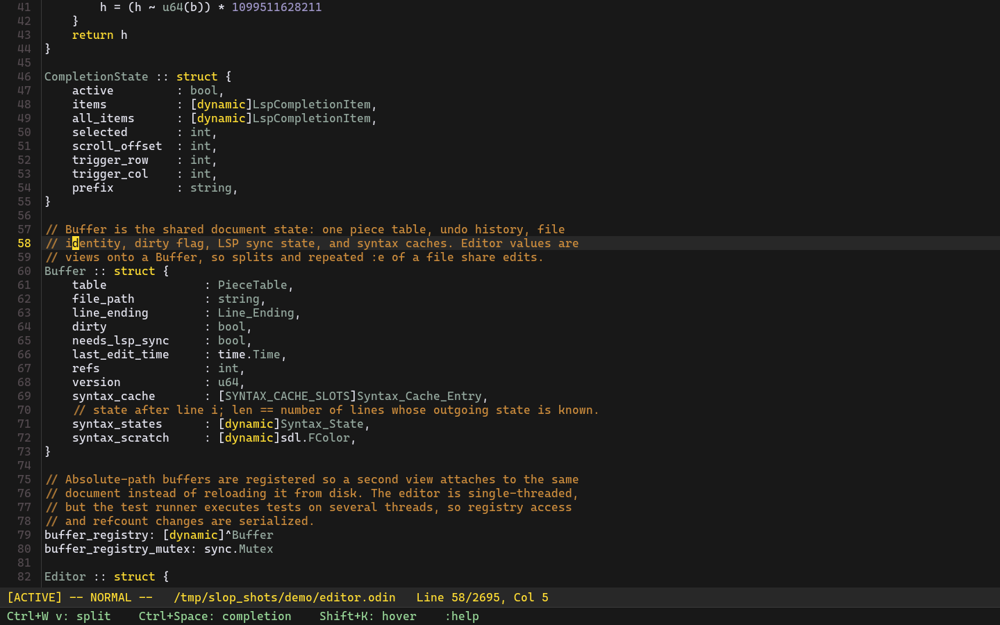
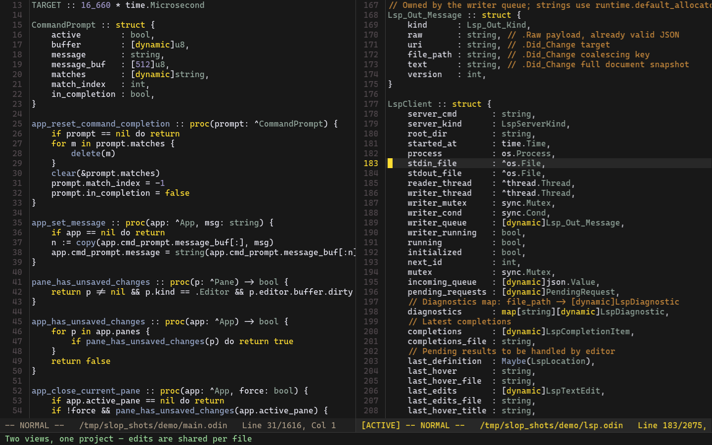
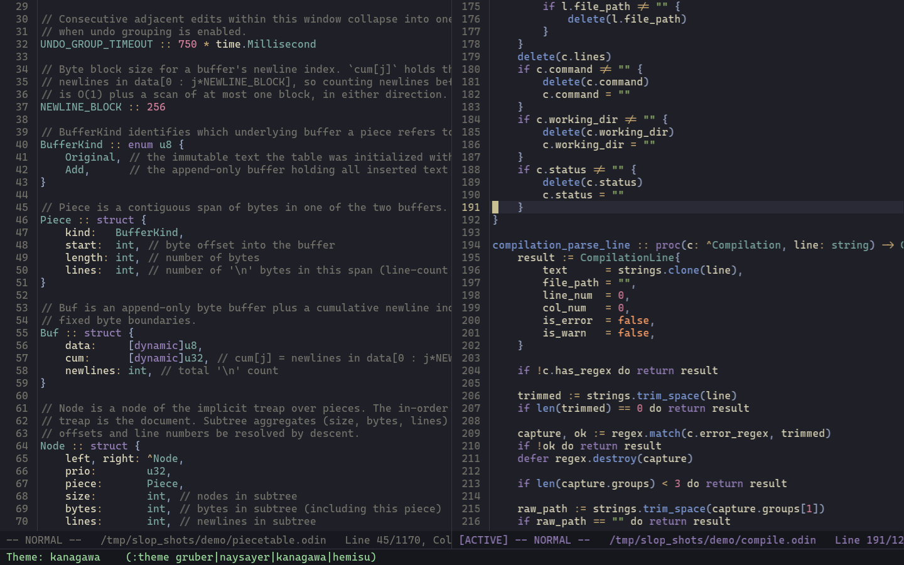
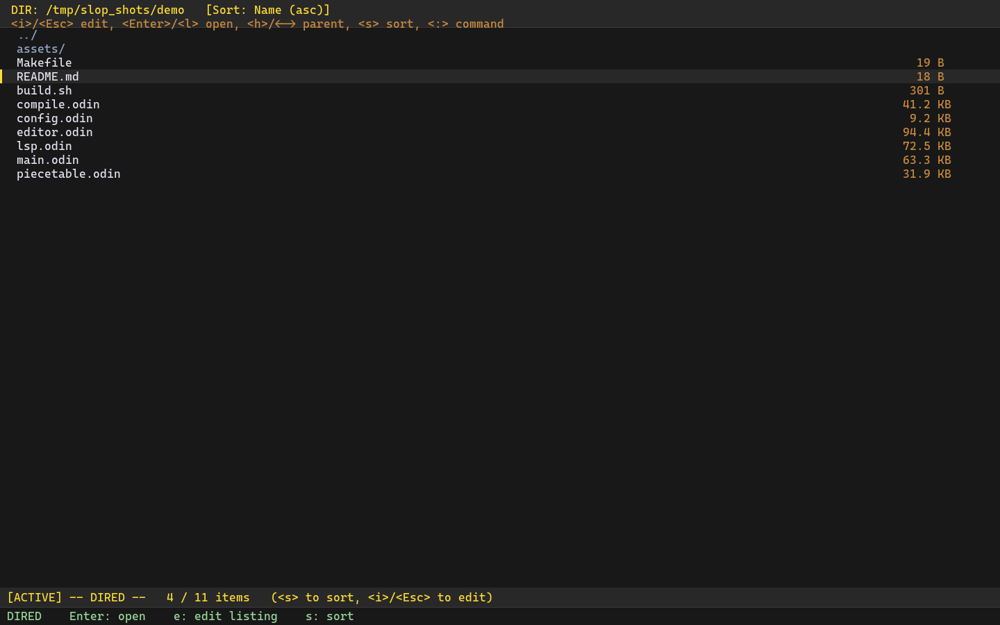
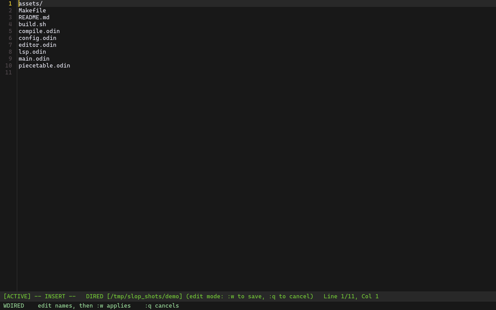
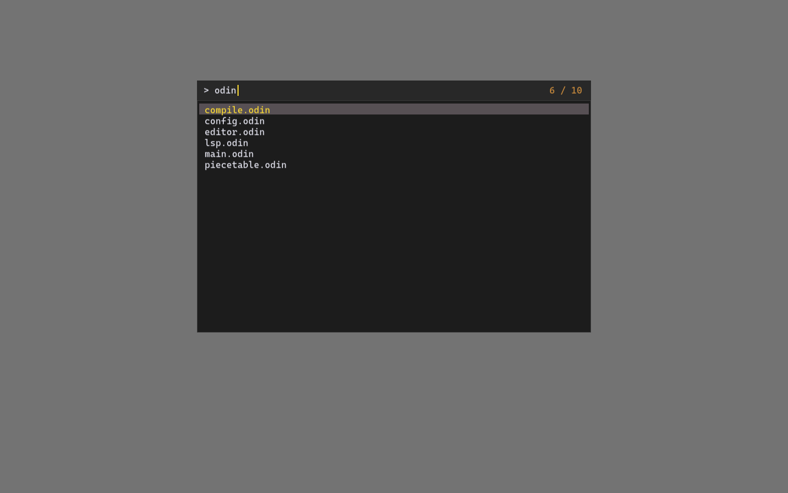
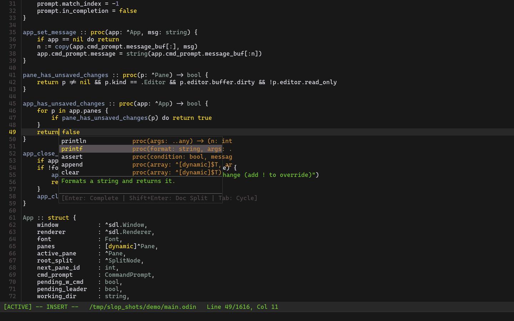
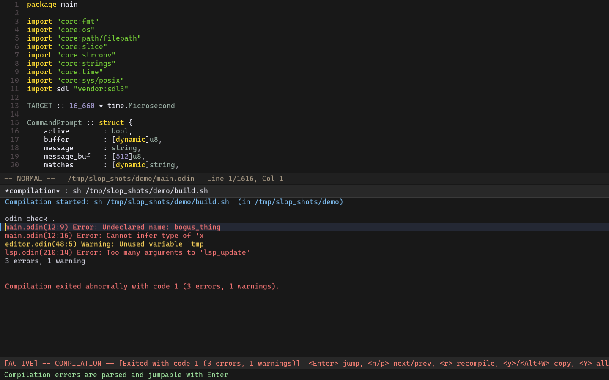
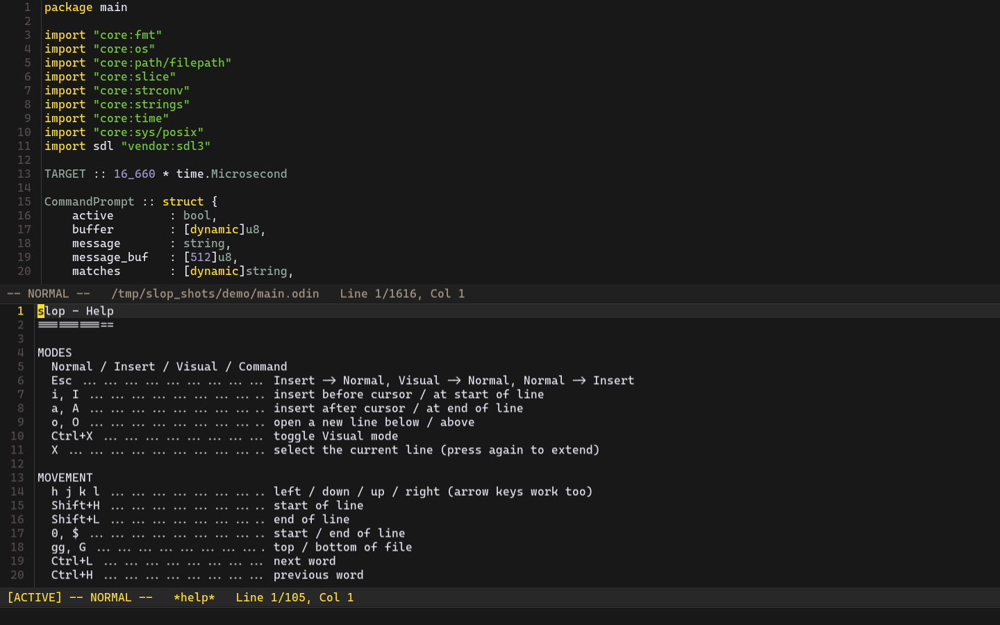
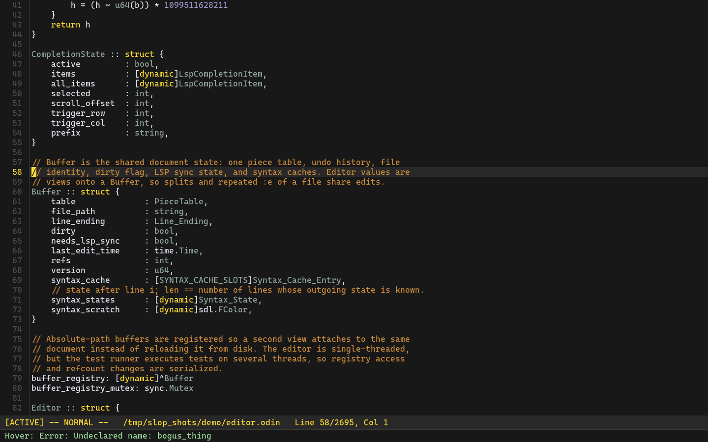

# slop

slop is an ultimate AI assisted config of neovim, somehow turned into a standalone editor.

## Features

### Editing

- Modal editing: Normal, Insert, Visual, and Command modes.
- Vim-style motions: `h j k l`, arrows, `gg` / `G`, `0` / `$`, `Shift+H` / `Shift+L`, word movement (`Ctrl+L` / `Ctrl+H`), and scope movement (`Ctrl+J` / `Ctrl+K`).
- Insert before/after, start/end of line, open lines below/above (`i I a A o O`).
- Character, line, and selection editing: delete, change, yank, paste.
- Line and selection moves with `Alt+J` / `Alt+K`.
- Auto-pairing for brackets and quotes, smart Enter indentation, four-space Tab.
- Forward search with `/pattern` in editor, dired, and compilation buffers; `n` / `N` / `p` repeat, matches wrap and highlight.
- Undo/redo with typing coalescing and explicit transactions, so compound edits undo as one step.
- Rune-aware cursor movement and selection: wide characters, combining marks, and emoji do not split.
- CRLF files stay CRLF on every edit path.

### Buffers and panes

- Real shared buffers: the same file open in multiple splits shares text, undo history, dirty state, line endings, and LSP state.
- Horizontal and vertical splits, directional focus (`Ctrl+W h/j/k/l`), cycle (`Ctrl+W w`), close (`Ctrl+W q`).
- Dirty-buffer guards on close and quit.
- `:w`, `:wa`, `:wq`, `:wqa`, `:q`, `:qa`, `:qa!`.
- Per-view cursor, selection, and scroll positions.

### Files and directories

- Async file picker with substring, fuzzy, and multi-token matching.
- Picker skips VCS/build directories and editor backup files; scans are capped and report truncation.
- Dired: async listings, name/size/time sorting, reverse sort, parent navigation.
- Wdired: edit the listing to rename, create, and delete files, then `:w` to apply or `:q` to cancel.
- Project root and session working directory are independent (`:root`, `:cd`, `:pwd`).

### Language servers

- Per-project language server clients for Odin, Zig, C/C++, Rust, Go, and C3.
- Async startup, document refcounting, `didOpen` / `didChange` / `didClose`, and re-rooting on `:cd` / `:root`.
- Diagnostics underlined in the buffer and summarized in the status bar.
- Hover documentation, with error and warning diagnostics shown when the symbol does not type-check.
- Completion with item cycling and documentation in a split (`Shift+Enter`).
- Go to definition (`gd`), line and selection formatting.
- UTF-8 and UTF-16 position encoding negotiation.

### Compilation

- Async builds through the shell, with process-group cancellation.
- Error parsing for Odin and GCC/Clang/Rust-style output.
- Jump to errors from the output buffer; next/previous error navigation.
- Copy from the output buffer: `Ctrl+X` selects lines, `M-w` / `y` copies, `Shift+Y` copies everything.
- `r` recompiles, `gg` / `G` move to the top / bottom, `q` closes the pane.

### Appearance

- Embedded Caskaydia Cove Nerd Font with ligatures.
- Lazy Unicode glyph atlas and configurable fallback fonts.
- Four themes: Gruber Darker, Naysayer, Kanagawa, Hemisu.
- Runtime zoom and line-spacing controls.
- Syntax highlighting for Odin, Zig, C, C++, Rust, Go, C3, Hare, Rela, Bash, Lua, TOML, KDL, and Makefiles.
- Compile-time configuration in a single `config.odin`: font, theme, key bindings, LSP commands, picker caps.

### Help

- `:help` opens a read-only cheat sheet rendered with the current key bindings.

## Screenshots

### Split view

### Themes

### Dired and wdired

| | |
|---|---|
|  |  |

### File picker and completion

| | |
|---|---|
|  |  |

### Compilation and help

| | |
|---|---|
|  |  |

### Hover diagnostics

